<p align="center">
  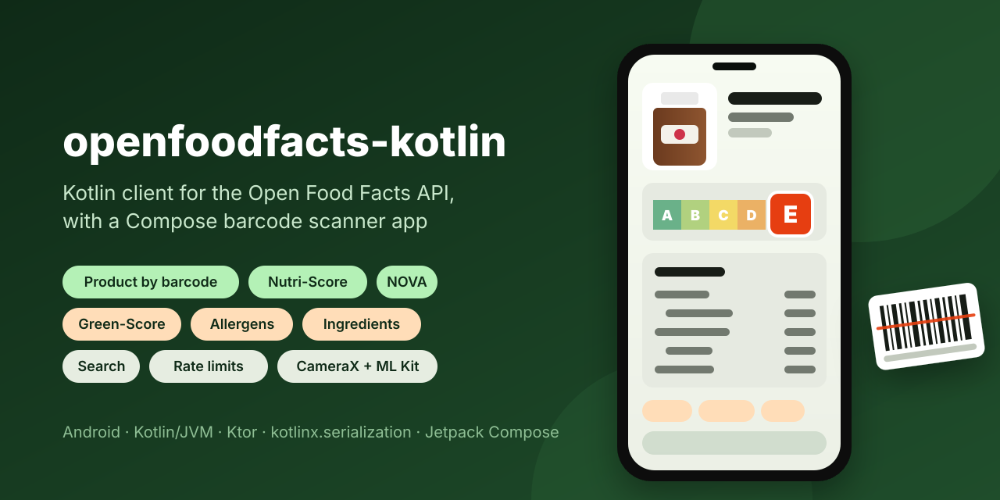
</p>

<p align="center">
  <a href="https://github.com/halilozel1903/openfoodfacts-kotlin/actions/workflows/ci.yml"></a>
  <a href="https://jitpack.io/#halilozel1903/openfoodfacts-kotlin"></a>
  
  
  
  
  
  <a href="LICENSE"></a>
</p>

**openfoodfacts-kotlin** is a coroutine client for the [Open Food Facts](https://world.openfoodfacts.org) API v2. Look a product up by barcode and get typed models for what matters on a food label: the Nutri-Score, the NOVA group, the Green-Score, nutrition per 100 g and per serving, the parsed ingredient list, allergens and traces, and photo urls in the size and language you want. Structured search filters by category, brand, label, country and Nutri-Score grade, with paging as a `Flow`. The client sends the custom `User-Agent` Open Food Facts requires and keeps to its published rate limits (100 product reads and 10 searches a minute), so an app cannot get itself blocked by accident. The core is pure Kotlin/JVM (Ktor and kotlinx.serialization), and the sample is a Compose barcode scanner built on CameraX and ML Kit.

```kotlin
val off = OpenFoodFactsClient(UserAgent(appName = "FoodScanner", version = "1.0", contact = "dev@example.com"))

val product = off.product("3017620422003")
product.displayName                     // the product name
product.nutriScore                      // NutriScore.A ... NutriScore.E, Unknown, NotApplicable
product.nova                            // NovaGroup.UltraProcessed, ...
product.nutriments.per100g.sugars       // grams of sugar per 100 g
product.allergens.map { it.displayName }   // e.g. [Milk, Nuts, Soybeans]
product.imageUrl(ImageKind.Front, ImageSize.Display, languages = listOf("en"))
```

## Screenshots

Captured live from Open Food Facts by CI, with the sample app on an Android emulator (Pixel 7). Product names, scores, nutrition values, ingredients, allergens and photos are real data loaded from world.openfoodfacts.org and images.openfoodfacts.org during the run. **The emulator has no camera pointed at a product, so scanning is shown through direct barcode entry**: the scan screen shows a typed barcode, and the product screens are opened by real barcodes (3017620422003 is Nutella, 5449000000996 is Coca-Cola), exactly as a scan opens them. On a device, the camera card reads the same barcodes with CameraX and ML Kit.

| Scan or type a barcode | Nutri-Score and nutrition | Allergens and ingredients |
| :---: | :---: | :---: |
| 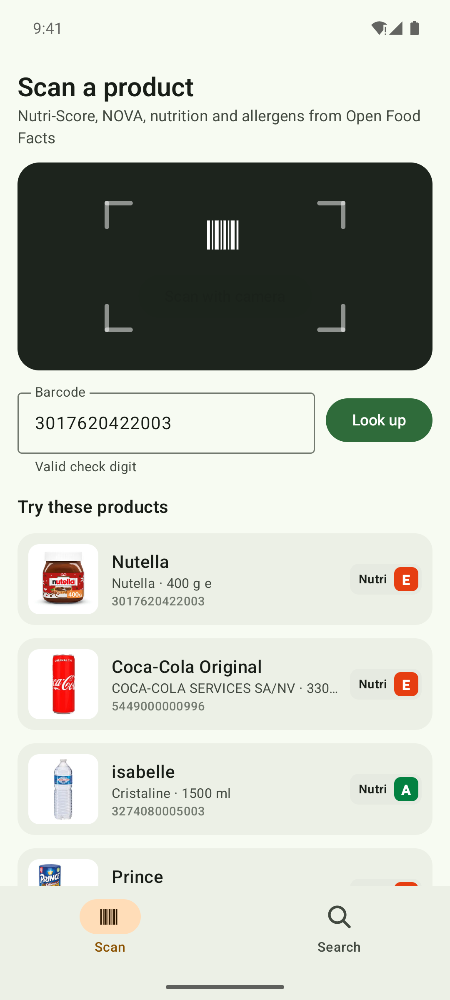 | 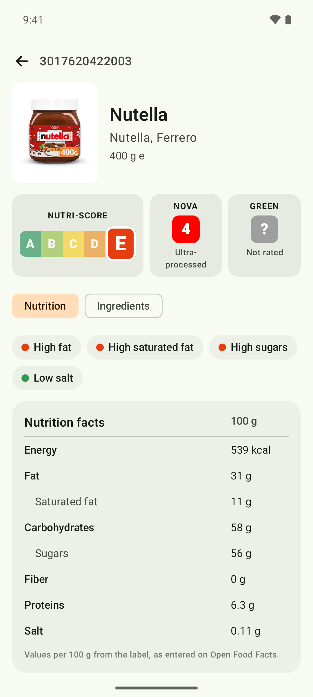 | 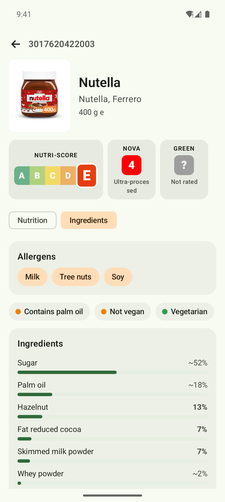 |

| Coca-Cola | Search with Nutri-Score filters |
| :---: | :---: |
| 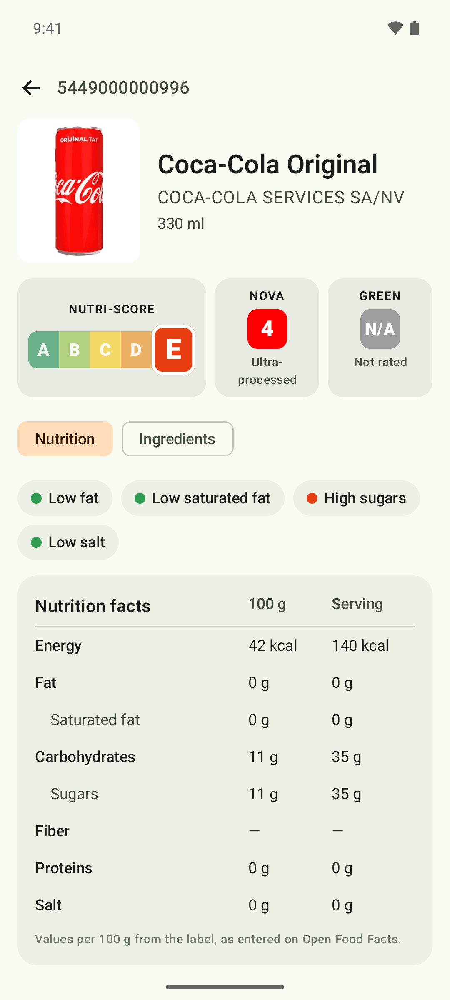 | 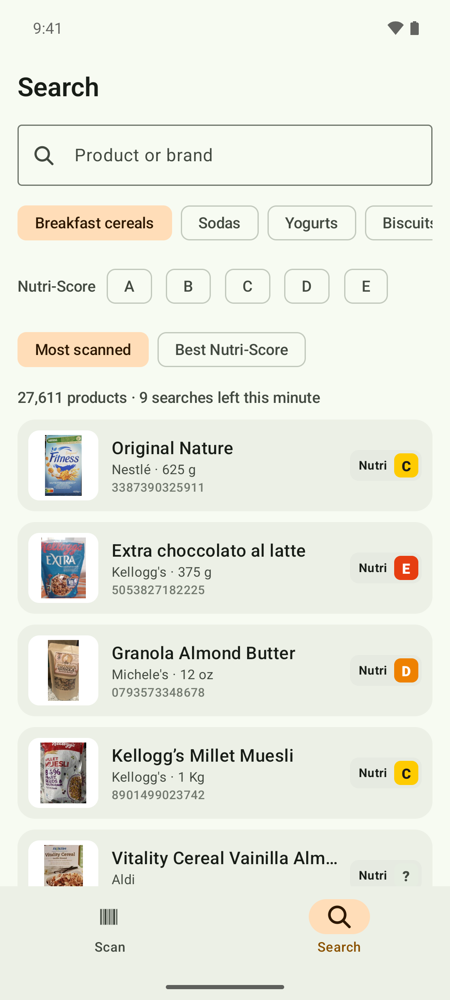 |

| Scan, dark | Nutrition, dark | Ingredients, dark | Coca-Cola, dark | Search, dark |
| :---: | :---: | :---: | :---: | :---: |
| 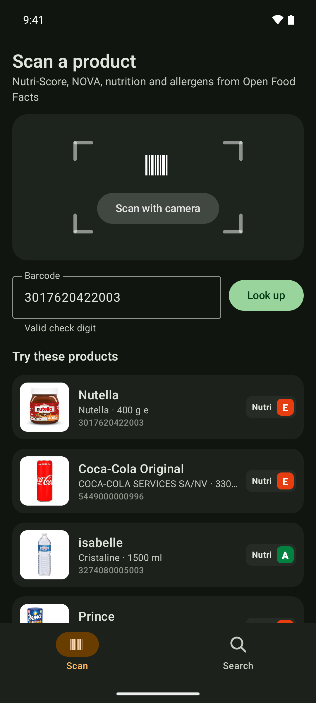 | 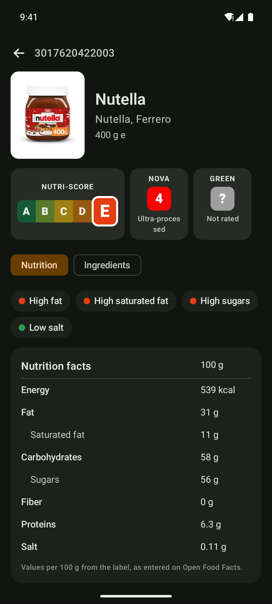 | 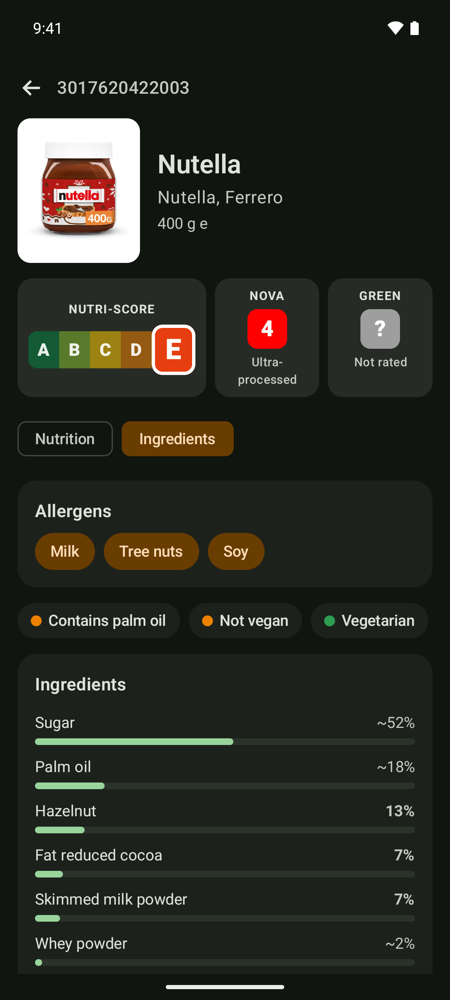 | 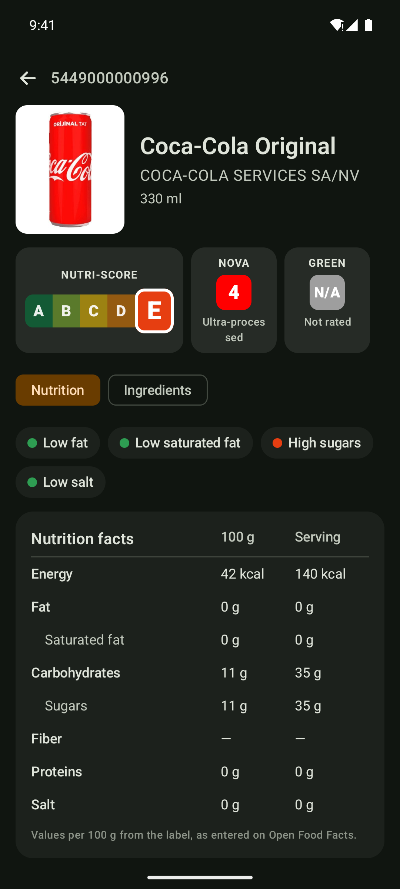 | 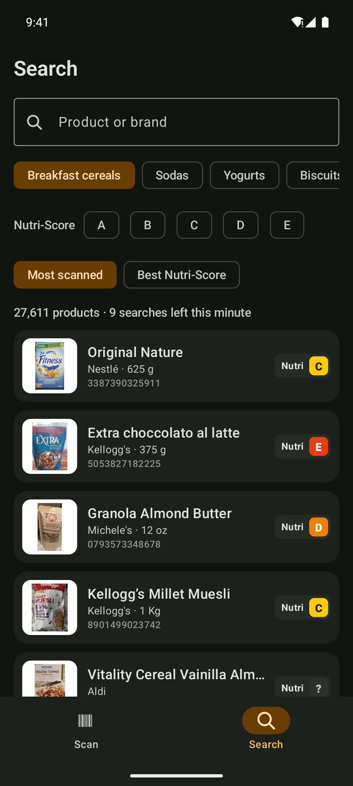 |

## Features

- **Products by barcode**: `GET /api/v2/product/{barcode}` with a `fields` list (`ProductFields.Summary` for lists, `ProductFields.Detail` for a product screen, or your own), and `NotFound` for unknown codes, whether the API answers `404` or `status: 0`.
- **Typed scores**: `NutriScore` (A to E, unknown, not applicable) with the scale's colours, `NovaGroup` 1 to 4 with labels, and `GreenScore` (A+ to F) read from `environmental_score_grade` or the older `ecoscore_grade`.
- **Nutrition**: `nutriments.per100g` and `perServing` as `NutritionFacts` (energy in kJ and kcal, fat, saturated fat, carbohydrates, sugars, fiber, proteins, salt, sodium), any other nutrient by key, units, and the traffic light `nutrient_levels`. Missing values stay `null`; kcal, kJ, salt and sodium are derived from each other when only one is given.
- **Ingredients and allergens**: the parsed ingredient tree with stated and estimated percentages and vegan, vegetarian and palm oil flags; `ingredientsAnalysis`; allergens and traces as `Tag`s with readable names; the 14 EU allergens as an enum (`product.contains(Allergen.Milk)`).
- **Images**: `product.imageUrl(kind, size, languages)` picks the front, ingredients, nutrition or packaging photo in thumb (100 px), small (200), display (400) or full size, preferring your languages, then the product's own, then English. It reads `selected_images`, builds urls from `images` revisions (the only way to get full size) and falls back to the flat `image_*_url` fields.
- **Search**: `SearchQuery` for `/api/v2/search` (categories, brands, labels, countries, Nutri-Score grades, sort order, page size, fields), `searchPages()` as a cold `Flow`, and `searchText()` for full text search through `/cgi/search.pl`.
- **Required User-Agent**: the client cannot be created without a `UserAgent` naming your app, version and contact, as Open Food Facts asks.
- **Rate-limit aware**: sliding window limiters at 100 product reads and 10 searches per minute by default. The client waits for a free slot or, if you prefer, throws `RateLimited` with the time to wait. A server `429` becomes `RateLimited` with its `Retry-After`. `remainingRequests(kind)` tells you what is left.
- **In-memory cache**: identical requests within 10 minutes (configurable) are served from memory and do not count against the limits.
- **Lenient decoding**: the API returns some numbers as strings (`"nova_group": "4"`, `"page": "1"`) and unknown values as `""`; the models read both, and ignore fields they do not know.
- **Barcode helpers**: normalize typed codes, check GTIN check digits (EAN-8, UPC-A, EAN-13, GTIN-14), and compute image folders.
- **Pluggable HTTP**: Ktor with CIO by default; pass OkHttp, Android, Java or a `MockEngine`, a ready `HttpClient`, or your own `OpenFoodFactsTransport`.
- **Explicit API**, unit tested against fixtures shaped like the API's responses.

### API coverage

| Open Food Facts endpoint | Function | Returns | Limit |
| --- | --- | --- | --- |
| `GET /api/v2/product/{barcode}?fields=` | `product(barcode, fields)`, `productOrNull(...)` | `Product` | 100 / min |
| `GET /api/v2/search?categories_tags=&nutrition_grades_tags=&sort_by=&page=&page_size=&fields=` | `search(query)`, `searchPages(query)` | `SearchPage`, `Flow<SearchPage>` | 10 / min |
| `GET /cgi/search.pl?search_terms=&json=1` | `searchText(terms, page, pageSize)` | `SearchPage` | 10 / min |
| `images.openfoodfacts.org` | `product.imageUrl(kind, size, languages)`, `ProductImages.url(...)`, `ProductImages.fileUrl(...)` | url | none |
| Product page | `productPageUrl(barcode)` | url | none |

| Model property | API field |
| --- | --- |
| `nutriScore` | `nutriscore_grade` (`nutriscoreScore`: `nutriscore_score`) |
| `nova` | `nova_group` |
| `greenScore` | `environmental_score_grade`, else `ecoscore_grade` |
| `nutriments.per100g`, `nutriments.perServing` | `nutriments.<nutrient>_100g`, `nutriments.<nutrient>_serving` |
| `nutrientLevel(nutrient)` | `nutrient_levels` |
| `allergens`, `traces` | `allergens_tags`, `traces_tags` |
| `ingredients`, `ingredientsAnalysis` | `ingredients`, `ingredients_analysis_tags` |
| `imageUrl(...)` | `selected_images`, `images`, `image_*_url` |

## Installation

Add JitPack to `settings.gradle.kts`:

```kotlin
dependencyResolutionManagement {
    repositories {
        google()
        mavenCentral()
        maven("https://jitpack.io")
    }
}
```

Then the dependency:

```kotlin
dependencies {
    implementation("com.github.halilozel1903.openfoodfacts-kotlin:openfoodfacts:1.0.0")

    // Optional on Android: use OkHttp instead of Ktor's CIO engine.
    implementation("io.ktor:ktor-client-okhttp:3.6.0")
}
```

> The build is also set up for Maven Central (`io.github.halilozel1903:openfoodfacts`) via the vanniktech publish plugin.

`openfoodfacts` is a plain Kotlin/JVM library (JDK 17+), so it also works on servers and desktops. On Android, add the `INTERNET` permission.

## Usage

**Create a client**

```kotlin
val off = OpenFoodFactsClient(
    // Required: "AppName/Version (contact)". Requests with a generic agent may be blocked.
    UserAgent(appName = "FoodScanner", version = "1.0", contact = "dev@example.com"),
) {
    engine = OkHttp.create()                 // default: CIO
    language = "en"                          // lc: language of names and ingredient texts
    country = "fr"                           // cc: country scope, optional
    rateLimits = RateLimits.Default          // 100 product reads, 10 searches a minute, waiting when used up
    cacheSize = 100                          // responses kept in memory; 0 turns the cache off
    cacheTtl = 10.minutes
    // baseUrl = "https://world.openfoodfacts.net"   // staging server while you develop
}
// ...
off.close()
```

Create one client and share it; it is safe to use from many coroutines and every call is main-safe.

**A product**

```kotlin
val product = off.product("3017620422003")          // spaces and dashes are ignored
off.productOrNull("0000000000000")                   // null instead of NotFound

product.displayName
product.brandList                                    // brands split from "brands"
product.quantity
product.nutriScore.letter                            // "A" ... "E", or null when not graded
product.nutriScore.color                             // 0xFF038141 ... 0xFFE63E11
product.nova?.label                                  // "Ultra-processed food and drink products"
product.greenScore.label                             // "A+" ... "F"
```

**Nutrition**

```kotlin
val per100g = product.nutriments.per100g
per100g.energyKcal
per100g.saturatedFat
per100g[Nutrient.Salt]
product.nutriments.perServing.sugars                 // null when the label has no serving values
product.nutriments.per100g("caffeine")               // any nutrient by key
product.nutrientLevel(Nutrient.Sugars)               // NutrientLevel.Low, Moderate or High
```

**Ingredients and allergens**

```kotlin
product.allergens.map { it.displayName }             // from allergens_tags, e.g. "en:milk" -> "Milk"
product.contains(Allergen.Gluten)
product.mayContain(Allergen.Peanuts)                 // traces
product.ingredientsAnalysis.palmOil                  // Presence.Yes, No, Maybe or Unknown
product.ingredientsAnalysis.vegan

product.ingredients.forEach { println("${it.name}: ${it.percent ?: it.percentEstimate}%") }
product.ingredients.flatMap { it.flatten() }         // with sub ingredients
```

**Images**

```kotlin
product.imageUrl()                                                   // front, 400 px, product language
product.imageUrl(ImageKind.Nutrition, ImageSize.Full, listOf("en"))  // nutrition table photo, full size
product.imageUrl(size = ImageSize.atLeast(pixels = 180))             // smallest size that is big enough
ProductImages.languages(product, ImageKind.Front)                    // languages with a front photo
```

**Search**

```kotlin
val page = off.search(
    SearchQuery(
        categories = listOf("breakfast-cereals"),     // "en:" is added when there is no prefix
        nutritionGrades = setOf(NutriScore.A, NutriScore.B),
        sortBy = SearchSort.Popularity,
        pageSize = 20,
    ),
)
page.count                                            // matches across all pages
page.products.map { it.displayName to it.nutriScore }
page.hasNextPage

off.searchPages(SearchQuery(brands = listOf("ferrero")), maxPages = 3).collect { /* ... */ }
off.searchText("dark chocolate 70%")                   // full text, via /cgi/search.pl
```

**Rate limits and errors**

```kotlin
val off = OpenFoodFactsClient(agent) {
    rateLimits = RateLimits(searchesPerMinute = 10, whenExceeded = RateLimitBehavior.Fail)
}

try {
    off.search(query)
} catch (e: OpenFoodFactsException.RateLimited) {
    showMessage("Try again in ${e.retryAfter}")      // the client's own limit, or the server's 429
} catch (e: OpenFoodFactsException.NotFound) {
} catch (e: OpenFoodFactsException.Network) {
}

off.remainingRequests(RequestKind.Search)             // searches left in the current minute
```

With the default `RateLimitBehavior.Wait`, a request over the budget suspends until it fits, so a loop that reads 150 products takes a little over a minute instead of getting blocked.

**Testing your code**

```kotlin
val off = OpenFoodFactsClient(UserAgent("MyAppTests", "1.0", "dev@example.com")) {
    transport = OpenFoodFactsTransport { url, _ -> TransportResponse(200, readFixture(url)) }
    rateLimits = RateLimits.None
}
```

Or pass a Ktor `MockEngine` as `engine`, as this library's own tests do.

## Sample app

The `sample` module is a food scanner for Android phones. The **Scan** tab has a camera card that reads EAN-13, EAN-8, UPC-A and UPC-E barcodes with CameraX and ML Kit's bundled model (after asking for the camera permission), a barcode field with check digit feedback, and real example products to open without a camera. A product opens with its photo, the Nutri-Score strip, NOVA and Green-Score tiles, then two tabs: **Nutrition** (nutrient levels and the nutrition table per 100 g and per serving) and **Ingredients** (allergens and traces, palm oil and vegan analysis, and the ingredient list with percentages). The **Search** tab searches categories with Nutri-Score filters and a sort order, or by words, with *Load more* paging and a count of the searches left this minute. Everything is live from Open Food Facts through one shared client, with OkHttp as the Ktor engine and Coil for photos.

For screenshots it opens a fixed screen from an intent extra (used by `scripts/screenshots.sh`):

```bash
./gradlew :sample:installDebug
adb shell am start -n io.github.halilozel1903.openfoodfacts.sample/.MainActivity --es scene product
```

`scene` is one of `scan` (a typed barcode and the example products), `product` (Nutella's nutrition), `ingredients` (Nutella's allergens and ingredients), `cola` (Coca-Cola's nutrition) or `search` (breakfast cereals, most scanned first). Scenes load live data through the same client as a normal launch and never start the camera; they log `SCENE_READY` once the data and every photo on screen have loaded. CI captures them on a Pixel 7 emulator in light and dark mode, and fails instead of capturing when a scene shows an error, does not finish loading, misses the expected text or is blank.

## Be nice to Open Food Facts

Open Food Facts is a non-profit, open database built by volunteers. Its [API documentation](https://openfoodfacts.github.io/openfoodfacts-server/api/) asks every app to send a custom `User-Agent`, to stay under 100 product reads, 10 searches and 2 facet queries per minute per user, and to use the staging server (`world.openfoodfacts.net`) while developing. Do not use the API to download the whole database: use the [data exports](https://world.openfoodfacts.org/data) instead.

## Data license

Open Food Facts data is available under the [Open Database License](https://opendatacommons.org/licenses/odbl/1-0/), and product photos under [CC BY-SA 3.0](https://creativecommons.org/licenses/by-sa/3.0/). Apps that show the data must credit Open Food Facts. This project is not affiliated with or endorsed by Open Food Facts; brand and product names belong to their owners. The screenshots show data and photos loaded from Open Food Facts; this repository does not otherwise include them.

## Project structure

| Module | What it is |
| --- | --- |
| `openfoodfacts` | Pure Kotlin/JVM: `OpenFoodFactsClient`, `UserAgent`, rate limiters, `SearchQuery`, models, score enums, `ProductImages`, `Barcode`. Published as `openfoodfacts` |
| `sample` | The Compose food scanner (CameraX, ML Kit, Coil), with screenshot scenes |

## Tech stack

Kotlin 2.4 · Ktor 3.6 (CIO, OkHttp) · kotlinx.serialization · kotlinx.coroutines · AGP 9.4 with built-in Kotlin · Gradle 9.6 · Jetpack Compose (BOM 2026.09) · Material 3 · CameraX 1.5 · ML Kit barcode scanning · Coil 3 · GitHub Actions with an Android emulator

## License

MIT. See [LICENSE](LICENSE).
